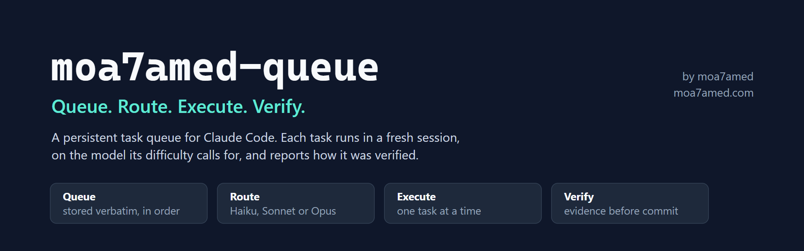
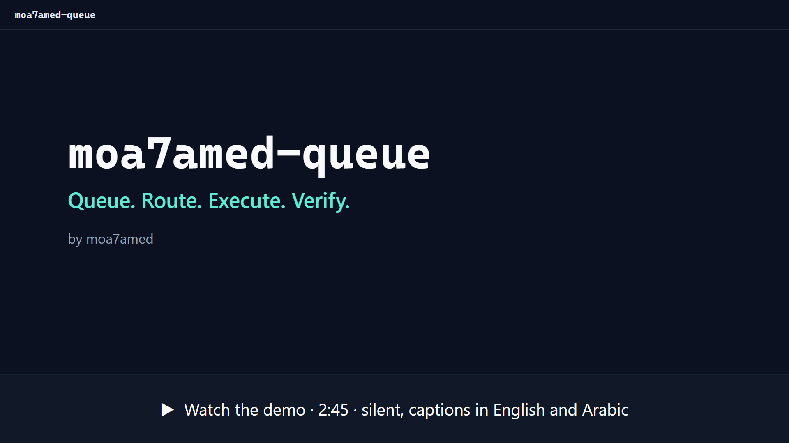

# moa7amed-tools

**moa7amed-queue is an intelligent task orchestrator plugin for Claude Code.** It is
published in moa7amed-tools, a free, open-source marketplace of
[Claude Code](https://code.claude.com/docs) plugins, created by **Mohamed Ibrahim
Ramadan** and published as **moa7amed** ([moa7amed.com](https://moa7amed.com/),
moa7amed@gmail.com). It is installed into Claude Code and executes queued tasks with the
Claude Code CLI; it is not a Codex or Cursor extension (see [Compatibility](#compatibility)).

> **Status: published.** moa7amed-queue 0.8.0 is available from this repository's
> marketplace on GitHub. Installing 0.8.0 from GitHub into an empty Claude Code profile was verified on 2026-11-21, and CI passes on Linux, Windows and macOS. Real Claude Code
> execution has been verified on Windows only, and updating from one published version to
> the next has not been tested yet: 0.8.0 is the first.

## moa7amed-queue



**Intelligent AI Coding Task Orchestrator. Queue. Route. Execute. Verify.**

### See it run

[](docs/demo.md)

[Watch the demo](docs/demo.md) (silent, with English or Arabic captions; about 2½ minutes,
or 40 seconds for the short cut). It replays a real session on a small synthetic project:
three tasks are queued and routed (a typo fix to Haiku, a feature to Sonnet, a security
fix to the DEEP workflow, set to Sonnet by hand); the runner executes them one at a time;
two read-only analysis agents examine the security fix at the same time; its plan waits
for the owner's approval; every result is committed and verified, and the project's tests
pass; a runner killed mid-task is recovered; BidStudio and Replica projects are started
from local documents. Every terminal line in it is real output, replayed; long waits are
sped up and labelled. More: [docs/demo.md](docs/demo.md), website
[moa7amed.com](https://moa7amed.com/).

Think of the next three things while Claude is still busy with the first, and queue them
instead of interrupting it. Each prompt becomes a persistent task. A runner outside your
session executes the tasks one at a time, each in a fresh Claude Code session, on the
model its difficulty calls for, and commits each result.

### Key features

| | |
| :-- | :-- |
| **Persistent queue** | Prompts and acceptance criteria are stored verbatim and cannot be edited or deleted. One queue per project, kept outside the project |
| **Strictly sequential** | One runner per project, one task at a time, guarded by a lock |
| **Model routing** | Each task runs on Haiku, Sonnet or Opus according to its difficulty, with manual overrides, fallback when a model is unavailable, and bounded escalation. Reads English, and Arabic (standard and Egyptian) |
| **Your work is safe** | No task starts on top of uncommitted changes unless you allow it. Nothing is ever discarded; a separate git worktree is available |
| **Crash recovery** | A task that finished before a crash is recorded, not run again; a task that was cut off is run again or held for your review. `reconcile` shows what was left behind and resolves it on your instruction |
| **Cost controls** | A budget per task enforced by Claude Code, a limit per runner session, warnings, and a report of what each task cost |
| **Adaptive workflow** | QUICK, STANDARD or DEEP process per task, decided from the task's analysis: no planning for a text change, a planning session and your approval for an architecture change, a verification report from every task. See [docs/workflow.md](docs/workflow.md) |
| **Replica** | Rebuild an application from a URL, screenshots, recordings, source or specifications: evidence-classified screen and feature inventory, a plan you approve, building in the queue, measured screenshot comparison, real browser tests, bounded correction rounds, clean-room rules for third-party references. See [docs/replica.md](docs/replica.md) |
| **BidStudio** | Tender analysis and proposals: every requirement quoted from its document, compliance matrix with evidence, clarifications and addenda with history, bid/no-bid, effort estimate, deterministic pricing (markup, margin, contingency, FX, tax), technical and commercial proposals (DOCX, PDF) and workbooks (XLSX) in English or Arabic, independent review. Never submits. See [docs/bidstudio.md](docs/bidstudio.md) |
| **Multi-agent analysis (stage A)** | When justified, read-only analysis agents run concurrently in separate Claude Code sessions (tool-restricted, on a snapshot of HEAD, shared budget); the task's own session stays the only writer and verifies. Most tasks stay single; parallel implementation writes are not implemented. See [docs/agents.md](docs/agents.md) |
| **Auto Queue** | Opt-in per project: a saved task starts a runner in the background when none is working; it runs eligible tasks one at a time and exits when idle. Pause, stop and an allowance for automatic runs; approvals and limits unchanged. See [docs/auto-queue.md](docs/auto-queue.md) |
| **Challenge, then execute** | A task with a concrete risk (credentials in code, security switched off, data deleted, history rewritten, production or publishing) can wait for your decision: the concern, its evidence and an alternative, once. You take the recommendation or proceed with your approach; the decision is stored and followed, and never lifts permissions, approvals or cost limits. `/moa7amed-queue:grillme` reviews on request. See [docs/challenge.md](docs/challenge.md) |
| **Project planning** | For new systems and major changes: requirements with evidence, the real deployment environment, architecture options checked against it, decision records, your explicit approval, and the approved tasks executed by the queue with a compliance check after each one. See [docs/planning.md](docs/planning.md) |
| **Updates** | Through Claude Code's plugin mechanism, with a health check and automatic backups |

### Requirements

Claude Code (tested with 2.1.329), Python 3.8 or newer (standard library only), git
(recommended; needed for commits, snapshots and worktrees). On Windows, Git for Windows
provides the `sh` the prompt-capture hook needs. Optional: a PDF text extractor for
BidStudio, Playwright with Chromium for Replica captures and PDF output.

### Compatibility

The current release, 0.8.0, is a Claude Code plugin. What works where:

| Where | What works | Needs | Tested |
| :-- | :-- | :-- | :-- |
| **Claude Code CLI, plugin installed** (native) | Everything: the `/moa7amed-queue:...` skills, the `queue:` prompt hook, the runner, planning, Replica, BidStudio | Claude Code, Python 3.8+, git (recommended), `sh` for the hook | Real sessions with Claude Code 2.1.329 on Windows 11 only; installing from GitHub verified; test suites pass on Windows, Linux and macOS (CI) |
| **`moa7amed-queue` command in a terminal** (standalone) | Queue management without a model: `add` (routing is local rules), `status`, `list`, `show`, `cancel`, `priority`, `config`, `usage`, and the `project`, `bid` and `replica` records | Python 3.8+ and the plugin's files (an installed plugin or a clone); see [the plugin README](plugins/moa7amed-queue/README.md#the-command-moa7amed-queue) | Windows, also with `claude` removed from `PATH`; Linux test suites |
| **Executing tasks** (`run`, `launch`, the runners), from any terminal | Each task runs in a new Claude Code session (`claude -p`) | **The Claude Code CLI, installed and signed in.** Without it no task can start: the attempt is recorded as failed with the reason, and `doctor` reports Claude Code as missing | Windows with the real CLI |
| **An editor's integrated terminal** (VS Code, Cursor, the shell of Codex or another tool) | The same as any terminal. This is terminal access, not an integration: tasks still run in Claude Code, not in the editor's own agent | As above | Not tested in Cursor or Codex |
| **Claude Code's IDE extensions** (VS Code, JetBrains) | Not verified | | Not tested |
| **Codex, Cursor or other agents, natively** | **Not implemented.** No adapters exist. Claude Code skills, hooks and plugin installation do not work in Codex or Cursor | | |
| **macOS** | The test suites pass in CI (Python 3.10 and 3.13) | | No real Claude Code session on a Mac |

### Install

The install commands run **in a terminal** and use the Claude Code CLI (`claude`). Inside
a Claude Code session the same steps are `/plugin marketplace add ...` and
`/plugin install ...`.

**From GitHub (recommended):**

```bash
# in a terminal
claude plugin marketplace add moa7amed/moa7amed-tools
claude plugin install moa7amed-queue@moa7amed-tools
```

**From a local clone:**

```bash
# in a terminal
git clone https://github.com/moa7amed/moa7amed-tools
claude plugin marketplace add ./moa7amed-tools
claude plugin install moa7amed-queue@moa7amed-tools
```

A marketplace added from a folder receives no automatic updates; run
`claude plugin marketplace update moa7amed-tools` after pulling new commits.

### Quick start

Install once → enable per project → submit with `queue:` → automatic execution.

In a Claude Code session, in a project you trust, turn on Auto Queue once (it shows what
that means and asks first):

```text
/moa7amed-queue:auto enable
queue: Add search to the customer page          <- saved as task #1; a runner starts in the background
queue: Add an export button to the report       <- saved as task #2; it waits behind #1
```

Claude Code puts each captured prompt back into the input box: press Esc twice before the
next message. From a terminal, `moa7amed-queue add "..."` does the same without the prompt
hook.

Only `queue:` prompts and explicit queue-add requests become tasks; ordinary messages go to
Claude as before. Without Auto Queue (the default for every project), tasks wait until you
start a runner. See [docs/auto-queue.md](docs/auto-queue.md).

Manual workflow, in a Claude Code session with the plugin installed:

```text
/moa7amed-queue:queue-add Add input validation to the signup form. Acceptance criteria: invalid e-mail addresses are rejected with a message
queue: Update the README for the new validation      <- typed prefix, captured by the hook
/moa7amed-queue:queue-status
/moa7amed-queue:queue-run
```

Or in any terminal, after creating the command once (`install-cli`, see
[the plugin README](plugins/moa7amed-queue/README.md#the-command-moa7amed-queue)):
`moa7amed-queue add "..."`, `moa7amed-queue status`, `moa7amed-queue run`. `run` needs
the Claude Code CLI; `add` and `status` do not.

### Multi-agent example

```bash
# in a terminal, in the project folder
moa7amed-queue add "Fix the SQL injection in the login function and add regression tests"
moa7amed-queue agents evaluate 1   # PARALLEL: 2 read-only subtasks (security_review, test_gap_analysis)
moa7amed-queue run                 # both agents analyse at the same time on a snapshot of HEAD,
                                   # then the task's own session implements, tests and verifies
moa7amed-queue agents show 1       # roles, pids, start/end, isolation, input revision, cost
```

A text change (`"Update the login button text"`) runs as one session with no agents.
Agents run concurrently only for justified, read-only analysis; the task's own session
is always the only writer. Parallel implementation writes are not implemented.

### Commands

| | |
| :-- | :-- |
| `add`, `status`, `list`, `show`, `history`, `log` | Queue and inspect tasks |
| `priority`, `depend`, `retry`, `cancel` | Order and manage them |
| `run`, `launch`, `plan` | Run the queue here, in the background, or show what would run |
| `model`, `route`, `models` | Choose or inspect the model per task |
| `reconcile`, `recover` | See and resolve what a crash left behind |
| `project ...` | Plan a project: requirements, infrastructure, decisions, tasks, approval, import |
| `usage` | What tasks cost, as Claude Code reported it |
| `update`, `doctor`, `backup`, `restore`, `changelog` | Upkeep |

### Queueing while Claude is working

Measured with Claude Code 2.1.329 in a real interactive session:

- A message that **starts with `queue:`** is stored as a task the moment you press
  Enter, even while Claude is in the middle of a turn or a tool call. It is not sent to
  Claude, and the running work is not interrupted.
- Claude Code then **puts that text back into the input box**. Press **Esc twice** to
  clear it. If you press Enter again, or type on and press Enter, the plugin recognises
  the repeat and does not queue it a second time.
- A message **without** the prefix goes to Claude as usual (Claude Code queues it and
  hands it to Claude when the current tool calls finish). It does not enter the task
  queue.
- If you need certainty that does not depend on the hook, use `moa7amed-queue add` in
  another terminal, or `/moa7amed-queue:queue-add` (Claude Code runs commands typed
  during a turn after that turn ends).

### Cost

The plugin is free. Running tasks uses your Claude account, billed by Anthropic
according to your plan; the plugin adds no charge of its own and needs no licence key.

What the controls guarantee, and what they do not:

| Control | What it does | Exact? |
| :-- | :-- | :-- |
| `max_budget_usd` | Passed to Claude Code (`--max-budget-usd`), which stops the task once its own cost estimate reaches it | No: the response that crosses the line still completes. Measured: a $0.01 budget stopped at $0.0138 |
| `cost_limit_run_usd` | Starts no further task once the session reached it, and gives each task at most what is left as its budget | Between tasks, plus Claude Code's overshoot of the last task |
| `cost_warn_task_usd`, `cost_warn_run_usd` | Warnings in the runner log | Warnings only |
| `usage` | Totals per model and per task | Claude Code's figures, which it calls client-side estimates; your bill is the authority |

A task stopped by its budget is not retried automatically.

### Security and privacy

Everything stays on your machine, in `~/.moa7amed-queue`. The plugin makes no network
connection itself and has no telemetry. Tasks run unattended under the permission mode
you choose (default `acceptEdits`). Details: [docs/security-and-privacy.md](docs/security-and-privacy.md).

### Limitations

- Tasks are unattended: Claude cannot ask you questions, and permission prompts are
  denied.
- Routing is a rule-based classifier with an optional one-line model review, not an
  oracle; its accuracy is measured on test sets only.
- Tested on Windows 11 (Python 3.8, 3.9 and 3.14) and on Linux under WSL (Python
  3.12). **macOS has not been tested**; the CI workflow covers it once the repository is
  on GitHub.
- The interactive capture behaviour above was observed with Claude Code 2.1.329 on
  Windows. Claude Code does not document hook behaviour for messages typed during a
  turn, so it may differ in other versions.

Full reference, settings and troubleshooting:
[plugins/moa7amed-queue/README.md](plugins/moa7amed-queue/README.md).

## Updates

```bash
claude plugin marketplace update moa7amed-tools
claude plugin update moa7amed-queue@moa7amed-tools
```

Claude Code can do this by itself, but for marketplaces other than its official one that
is off until you turn it on: `/plugin`, **Marketplaces** tab, select `moa7amed-tools`,
turn on auto-update. Going back to an earlier version:
[docs/updates-and-rollback.md](docs/updates-and-rollback.md).

## Implemented and roadmap

| Area | State |
| :-- | :-- |
| Persistent queue, sequential runner, locking, crash recovery, git safety | implemented |
| Model routing (Haiku/Sonnet/Opus), manual overrides, fallback, escalation | implemented |
| Adaptive workflow (QUICK/STANDARD/DEEP), verification reports | implemented |
| Project planning with owner approval | implemented |
| Replica, BidStudio | implemented (BidStudio never submits) |
| Multi-agent stage A: one coordinator, concurrent read-only analysis agents, one writer | implemented (0.8.0) |
| Challenge, discuss, then execute (`grillme`): evidence-backed concerns, owner decisions | implemented (0.8.0) |
| Multi-agent stage B: parallel implementation writes with file ownership and integration | **roadmap, not implemented** |
| Critical-path analysis, cost optimisation of architectures, drift detection beyond the post-task check, infrastructure benchmarking | roadmap |
| Hosted marketplace on GitHub | published (0.8.0); installing from it verified |
| Automatic updates between published versions | through Claude Code; not tested yet (needs a second published version) |

### Not verified yet

- A real Claude Code session on macOS or Linux. Real execution was verified on Windows
  only; on Linux, Windows and macOS the test suites pass in CI, with a stand-in for
  Claude Code.
- Updating from one published version to the next, including Claude Code's background
  auto-update, and adding the marketplace at a branch or tag.
- Claude Code's IDE extensions (VS Code, JetBrains). Codex and Cursor have no native
  adapters: not implemented.
- Multi-agent behaviour with Claude Code versions other than the one tested, and with
  MCP servers that write (outside the agents' tool restrictions).

## Troubleshooting

`moa7amed-queue doctor` checks the installation; `moa7amed-queue status` shows holds
(for example `agents:` or `approval:`); `moa7amed-queue reconcile` shows what a crash
left behind. More: [Troubleshooting](plugins/moa7amed-queue/README.md#troubleshooting).

Planned plugins, **not built**: `moa7amed-review` (reviewing a change before it is committed),
`moa7amed-ui` (checking interface work), `moa7amed-qa` (test plans),
`moa7amed-release` (release preparation for your own projects). The names are reserved;
nothing in this repository depends on them.

## Repository

```text
.claude-plugin/marketplace.json    the marketplace
plugins/moa7amed-queue/            the plugin: everything a user receives is in this folder
docs/                              contributor documentation
scripts/                           release tooling
release/baselines.json             earlier versions the upgrade tests start from
.github/workflows/                 CI and the release record
tests/                             checks for the marketplace as a whole
```

| Documentation | |
| :-- | :-- |
| [Architecture](docs/architecture.md) | How the repository and the queue plugin are built |
| [Project planning](docs/planning.md) | Planning before building, with a worked example |
| [Plugin development](docs/plugin-development.md) | Adding a skill, agent, hook, MCP server or plugin |
| [Writing skills](docs/skills-development.md) | The skill file, and what its description costs |
| [Updates and rollback](docs/updates-and-rollback.md) | For users and maintainers |
| [Versioning](docs/versioning.md) | Version numbers, compatibility, data format, channels |
| [Release checklist](docs/release-checklist.md) | First public release, every release, a bad release |
| [GitHub release steps](docs/github-release.md) | The exact steps the owner runs to publish 0.8.0 |
| [Multi-agent execution](docs/agents.md) | Stage A: when agents run, enforcement, recovery, budgets |
| [Challenge, discuss, then execute](docs/challenge.md) | Concerns, the owner's decisions, and what they cannot change |
| [Auto Queue](docs/auto-queue.md) | Opt-in automatic runner per project: consent, pause, stop, idle timeout, allowance |
| [Directory submission](docs/directory-submission.md) | Listing materials for the Claude plugin directory (prepared, not submitted) |
| [Changelog](plugins/moa7amed-queue/CHANGELOG.md) | What changed in each version |
| [Security and privacy](docs/security-and-privacy.md) | What is stored, started and sent |
| [Contributing](CONTRIBUTING.md) | Where to start |

## License

[MIT](LICENSE). Copyright (c) 2026 Mohamed Ibrahim Ramadan (moa7amed). Free to use,
modify and distribute, commercially or not. The plugins contain no third-party code;
they use only the Python standard library and the programs already on your machine
(Claude Code, git). Each plugin folder carries its own copy of the license.
