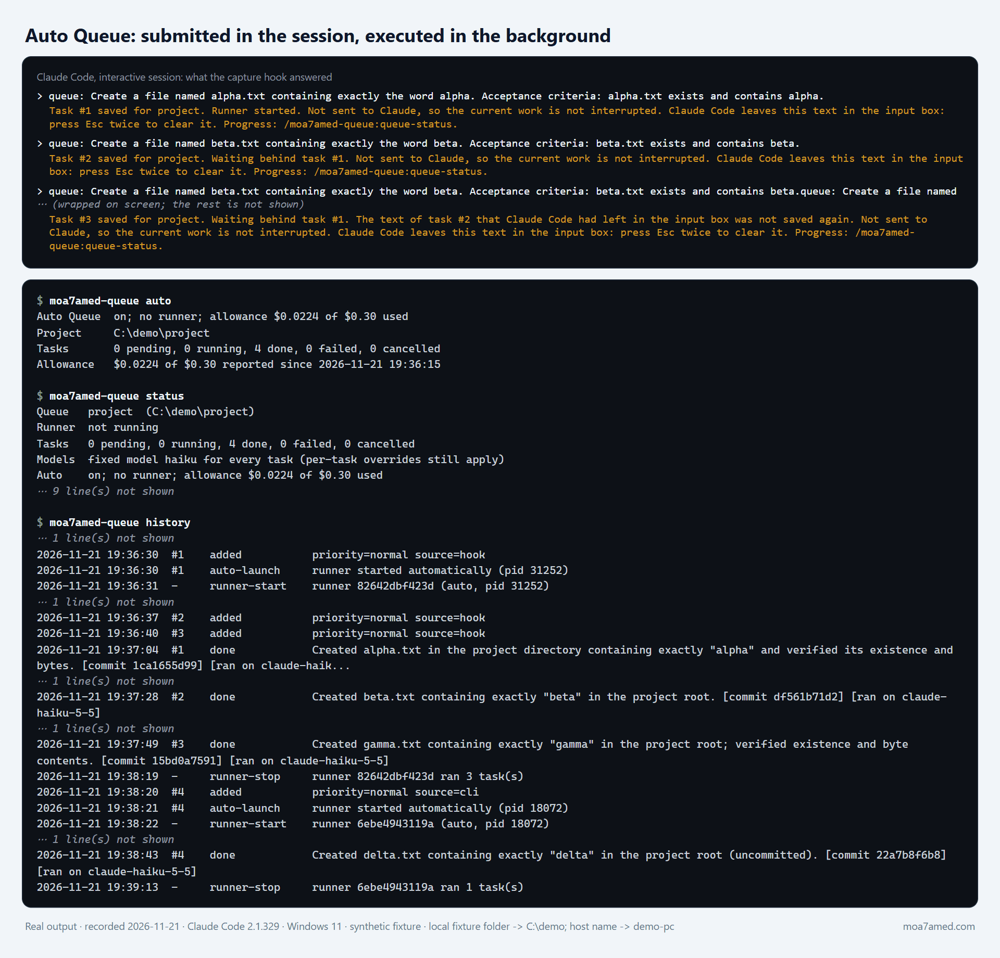

# Auto Queue

Install once → enable per project → submit with `queue:` → automatic execution.

Without Auto Queue, a saved task waits until you start a runner (`/moa7amed-queue:queue-run`
or `moa7amed-queue run`). With Auto Queue on for a project, saving a task there starts a
runner in the background when none is working. The runner is the same one you would start
yourself: it executes eligible tasks one at a time, each in its own Claude Code session
(`claude -p`), and exits after a few minutes without work. The next saved task starts it
again.

Auto Queue is part of the moa7amed-queue Claude Code plugin and needs the Claude Code CLI to
execute tasks. Native integrations for Codex or Cursor are not implemented.



## Installing is not enabling

Installing the plugin makes its commands available in every project. It executes nothing by
itself, and Auto Queue is off in every project until you turn it on for that project:

```text
/moa7amed-queue:auto enable          (in Claude Code; shows what it means, then asks)
```

```bash
moa7amed-queue auto enable           # in a terminal, in the project: shows what it means
moa7amed-queue auto enable --yes     # turns it on
```

What `auto enable` shows for the project, before anything changes:

- which folder will execute tasks;
- the runner's permissions (`permission_mode`, allowed and disallowed tools); nothing is
  widened;
- where tasks run: the project folder (a task starts only when it has no uncommitted
  changes) or, with `--worktree`, a separate git worktree so you can keep working;
- the cost terms (see [Cost](#cost)): the allowance for automatic runs, the per-task and
  per-session limits, and what these figures are and are not;
- how long the runner waits for new tasks before it exits;
- how to pause, stop and turn it off.

Options: `--worktree`, `--budget USD` (allowance for automatic runs, default 5),
`--no-budget` (no allowance; only the per-task and per-session limits apply).

The choice is stored in the project's settings (`auto_queue_enabled`). The setting is
ignored in the global settings file, and `config set auto_queue_enabled true --global` is
refused, so no global switch can make every project execute tasks. A queued task cannot turn
Auto Queue on.

## Submitting work

Only explicit submissions become tasks:

| Where | How | Notes |
| :-- | :-- | :-- |
| Terminal (most direct) | `moa7amed-queue add "Add search to the customer page"` | No prompt hook involved; works from any terminal, including an editor's. |
| Claude Code prompt | `queue: Add search to the customer page` | Captured by the plugin's prompt hook; see below. |
| Claude Code | `/moa7amed-queue:queue-add Add search to the customer page` | Claude stores the request with the same command. |

Ordinary messages, questions, discussion and pasted logs go to Claude as before. Auto Queue
does not look at them.

### What happens after `queue: ...` in Claude Code

1. The prompt hook saves the text exactly as typed as one task in the project's queue
   database (a database transaction, not a git commit).
2. Only after that transaction it checks the project's runner and answers:
   - none working: it starts one, hidden, in the background → `Task #42 saved. Runner started.`
   - one working on another task → `Task #43 saved. Waiting behind task #42.`
   - paused → `Task #44 saved. Automatic execution is paused.`
   - nothing can run (an approval, a decision, a failed prerequisite) →
     `Task #45 saved. Blocked: ...`; no runner is started
   - the start failed → `Task #46 saved. Runner launch failed: <reason>.` The task stays
     pending.
3. The prompt is not sent to Claude, so the turn in progress is not interrupted.

"Runner started" means a process was started, not that the task runs.
`/moa7amed-queue:queue-status` shows each task's state (`pending`, `running`, `blocked`,
`failed`, `done`); a task counts as done only after its verification.

### Clear the input box after each `queue:` prompt

Claude Code puts a blocked prompt back into the input box (observed with 2.1.329). **Press
Esc twice to clear it before typing the next message.** If you do not:

- Enter on the unchanged text: not saved again (`NOT queued again`).
- `queue: next request` typed straight after the restored text: only the new request is
  saved; the restored text is not saved again (observed in a real session).
- Anything else typed after the restored text: nothing is saved and nothing is sent to
  Claude, because it could be a change to the earlier task, a new task or a message for
  Claude. The reply says so, quotes the new text, and `moa7amed-queue history` keeps it
  (`intake-refused`). Clear the box and submit the new part on its own.

A slash command typed after restored text is not a command either; clear the box first.

### Duplicates

Claude Code gives each prompt an id (`prompt_id`, seen in every real submission during
testing). A prompt delivered twice with the same id is saved once. `moa7amed-queue add
--request-id ID` does the same for scripts. Without an id, `moa7amed-queue add` always saves a
new task, so the same request can be submitted again on purpose. This is local
deduplication of submissions; it does not make the work itself happen exactly once.

### The hook's time limit

Claude Code gives a prompt hook 30 seconds. When a hook runs out of time, Claude Code by
default sends the prompt to Claude: in a test where the hook was made to overrun, the task
was saved and Claude also answered the prompt in the session, so the same request was owned
twice. The plugin therefore:

- keeps the hook short: waiting for the queue database is limited to 8 s, the workspace
  check to 5 s, starting a runner to 12 s; the backup on the first run after an update is
  made in the hook only when the queue data is small (up to 32 MB), otherwise by the next
  command before it writes anything (normally the hook answers in under 1.5 s);
- sets `onFailure: "block"` on its hook, so that Claude Code blocks the prompt instead of
  sending it when the hook fails or times out. Verified with Claude Code 2.1.329: the
  overrunning hook's prompt was not sent. Claude Code documents this setting from 2.1.295;
  with an earlier version a hook that runs out of time can still let the prompt through.

If the hook cannot save a task (for example while the queue database is locked by another
process for more than 8 s), the prompt is blocked and the reply says it was not saved; submit
it again, or use `moa7amed-queue add` in a terminal.

## One runner per project

Auto Queue starts the portable runner (`moa7amed-queue run --watch` with an idle timeout)
and uses the project's existing runner lock:

- Several tasks can be saved at the same time; only one runner holds the lock.
- A start is reserved in the queue database first, so concurrent submissions start at most
  one process; a runner that finds the lock taken exits and loses nothing.
- The lock records the runner's process id, host and start time, so a reused process id is
  never mistaken for the runner and never stopped.
- A worktree uses the same queue and lock as its project.

## How long the runner lives

The runner waits up to `auto_queue_idle_timeout_seconds` (default 300) for new work and then
exits; a submission wakes it at once. It gives the lock back only in the same database
transaction that confirms nothing is runnable, so a task saved at that moment is either
picked up or starts a new runner. When everything left is blocked, it exits after the
timeout and new submissions start no runners until something becomes runnable; approving a
plan, deciding a concern or retrying a task starts one when that makes work runnable.

Observed on Windows 11 with Claude Code 2.1.329: the runner started from an interactive
session kept running after that session was closed with `/exit` while one task ran and two
waited; it finished all three, one after another, then exited when idle, and a later
submission from a terminal started a new runner. A session that is killed instead of exited,
and macOS and Linux, were not tested with a real session. The runner is an ordinary process of
your user session: shutting down or logging off ends it, and the next submission or
`moa7amed-queue auto start` starts it again, with the usual crash recovery. No service,
scheduled task, login item or startup entry is installed. On Windows the runner has no
window; on macOS and Linux it runs in its own session.

The runner does not inherit the identifiers of the Claude Code session that started it
(`CLAUDECODE`, `CLAUDE_CODE_SESSION_ID`, its messaging socket and token, ...). Provider and
configuration variables (`ANTHROPIC_*`, `CLAUDE_CONFIG_DIR`, ...) are kept, so the tasks use
the same Claude Code login.

## Pause, stop, turn off

| Action | Command | Effect |
| :-- | :-- | :-- |
| Pause | `moa7amed-queue auto pause` | No new task is claimed; the running task finishes. Applies to every runner of the project, also one you start yourself, and survives restarts. |
| Resume | `moa7amed-queue auto resume` | Claiming starts again; a runner is started if work is waiting. Does not renew the allowance. |
| Stop after the current task | `moa7amed-queue auto stop` | The runner finishes its task and exits. With Auto Queue on, the next submission starts a new one; pause first to prevent that. |
| Stop now | `moa7amed-queue auto stop --now --yes` | Stops the runner and its task process (only the processes the lock recorded). The task is held for review, not retried, because it may have done part of its work; uncommitted changes stay. Automatic execution is paused. |
| Turn off | `moa7amed-queue auto disable` | No more automatic starts. Tasks and data are kept; a working runner finishes as usual. Enabling again keeps the allowance as it was. |
| Start now | `moa7amed-queue auto start` | Starts a runner if work is waiting or a stopped runner left something to recover. |
| State | `moa7amed-queue auto` (or `/moa7amed-queue:auto`) | State, runner, allowance and blockers; `auto blockers` lists only the blockers. |

## What stays the same

Automatic execution is not automatic approval. Plan and architecture approval, owner
decisions on concerns, dependencies, the uncommitted-change protection, git checkpoints,
model availability and overrides, verification and the cost limits apply exactly as for a
runner you start yourself. A blocked task keeps its reason; other eligible tasks go ahead.
Auto Queue never widens permissions, never changes Claude Code's global settings and never
bypasses the folder-trust dialog. A task that needs a permission the runner does not have
reports that, as before.

## Cost

`cost_limit_run_usd` counts per runner session and starts again with each runner. Automatic
runners therefore also have an allowance that does not:

- `auto_queue_budget_usd`, $5 unless you choose another amount (`--budget USD`) or none
  (`--no-budget`) when enabling. Automatic runners start no new task once Claude Code has
  reported that much for queued work in the project since the allowance was granted; all
  runs since then count, also those of runners you started yourself.
- It is renewed only by `moa7amed-queue auto budget --renew` (or `--set USD`), never by
  restarting, resuming, or disabling and enabling again.
- A task never gets more than what is left; the remainder is passed to Claude Code as
  `--max-budget-usd`.

What the figures are: what Claude Code reports after each run. They are soft limits:
the check happens before a task starts, a running task can end above the limit (Claude Code
enforces `--max-budget-usd` on its own estimate), and a run that is cut off may report no
usage at all. Such runs are listed as unknown, never counted as $0, so totals are a lower
bound when unknown runs exist. The allowance does not buy credits, reserve funds or cap
spending at the provider. Auto Queue makes no model call of its own: saving a task, routing
it and keeping the runner waiting cost nothing.

## Recovery

- **The runner was killed, or the machine restarted:** the next submission, or
  `moa7amed-queue auto start`, starts a runner, also when nothing is pending (the cut-off task
  is still marked running). It records the interruption: the task goes back in line, or waits
  for you with `on_interrupted=hold`. Verified live with a run cut off before it changed
  anything.
- **The cut-off task left uncommitted changes:** in the project folder, the runner does not
  work over them; `moa7amed-queue auto blockers` says so and `moa7amed-queue reconcile` shows
  them. Commit or stash them, then `moa7amed-queue auto start`. (Covered by the automated tests
  with a stand-in for Claude Code, not by a live run.)
- **"Runner launch failed":** the reason follows. After three failed starts in a row,
  automatic starting stops until `moa7amed-queue auto resume`. The runner's own output is in
  `launch.out` and `runner.log` in the queue's data folder (`moa7amed-queue where`).
- **A task stays pending:** `moa7amed-queue auto blockers` says why (paused, allowance,
  uncommitted changes, approval, decision, prerequisite).

## Settings

| Setting | Default | Meaning |
| :-- | :-- | :-- |
| `auto_queue_enabled` | `false` | Start a runner when a task is saved (project settings only). |
| `auto_queue_idle_timeout_seconds` | `300` | An automatic runner exits after this long without a task. |
| `auto_queue_launch_retry_limit` | `3` | Failed starts in a row before automatic starting stops (until `auto resume`). |
| `auto_queue_budget_usd` | unset (5 when enabled) | Allowance for automatic runs; 0 = none. |

## What was verified, and where

| What | How |
| :-- | :-- |
| Submission through a real interactive Claude Code session, the hook's answers, one runner, sequential execution, the session closed with `/exit` while work was queued, restart after idle | Live, Windows 11, Claude Code 2.1.329, Haiku, a throwaway fixture |
| The hook running out of time, with and without `onFailure: "block"`; ordinary prompts still reaching Claude | Live, same setup, with a deliberately slow copy of the hook |
| Concurrency, launch failures and limits, pause/stop/disable, allowance across restarts, crash recovery including partial changes, request ids, locked database, hanging start | Automated tests with a stand-in for Claude Code, on Windows and Linux |
| macOS; a real session on Linux or macOS; a killed (not exited) session; Claude Code versions other than 2.1.329 | Not verified |
