# moa7amed-queue demo

**moa7amed-queue**, an intelligent task orchestrator plugin for Claude Code, by moa7amed ·
Queue. Route. Execute. Verify. · [moa7amed.com](https://moa7amed.com/)

The demo shows the plugin in the Claude Code CLI and the `moa7amed-queue` command in a
terminal; queued tasks are executed by Claude Code.

[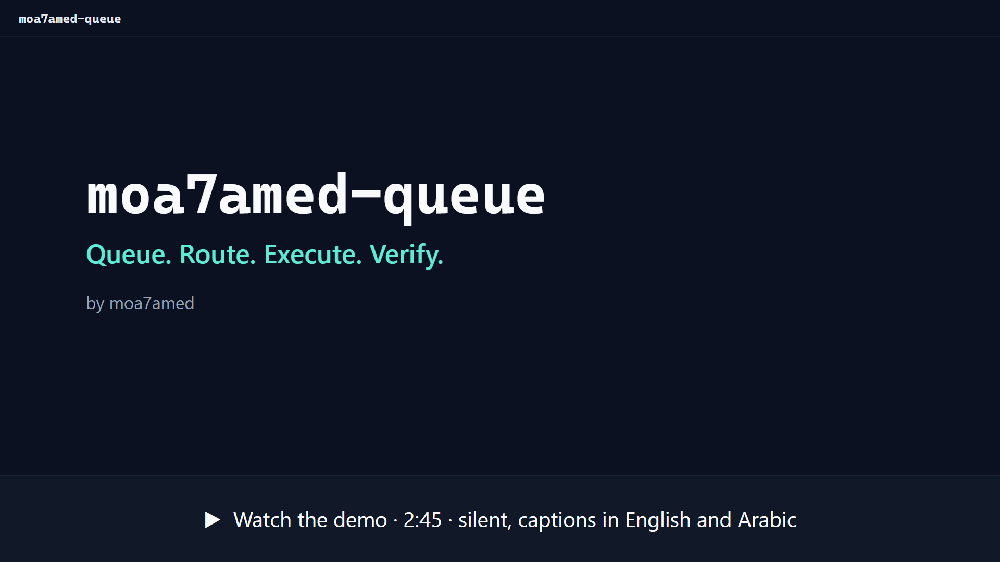](media/video/demo-en.webm)

## Videos

| Video | Length | Size | Captions |
| :-- | :-- | :-- | :-- |
| [Main, English captions](media/video/demo-en.webm) | 2:45 | 3.2 MB | burned in; also [demo-en.en.vtt](media/video/demo-en.en.vtt) |
| [Main, Arabic captions](media/video/demo-ar.webm) | 2:45 | 3.2 MB | burned in (right to left); also [demo-ar.ar.vtt](media/video/demo-ar.ar.vtt) |
| [Short, English captions](media/video/demo-short-en.webm) | 0:36 | 0.65 MB | burned in; also [demo-short-en.en.vtt](media/video/demo-short-en.en.vtt) |
| [Short, Arabic captions](media/video/demo-short-ar.webm) | 0:36 | 0.65 MB | burned in; also [demo-short-ar.ar.vtt](media/video/demo-short-ar.ar.vtt) |

WebM (VP9), 1920×1080, 10 frames per second, **silent**: there is no voice-over and no
music. GitHub may not play a WebM file inline in every browser; the links open the file
itself, which current browsers play. The videos are served from this repository only;
no other hosted copy (for example a release asset) exists. The
[storyboard](media/source/storyboard.md) holds every scene with its timing, the captions
in both languages, and an English and an Arabic narration script for a voice-over that
has not been recorded.

## What the demo shows (text alternative)

A real session, recorded on 2026-11-21 with Claude Code 2.1.329 on Windows 11, on a small
synthetic project (`notes-app`, a command-line notebook with an SQL injection in its
search function). Each scene replays the commands and their exact output:

1. **Queue.** Three tasks are added. The rules route the typo fix to Haiku (QUICK), the
   `--tag` feature to Sonnet (STANDARD), and the SQL injection fix to the DEEP workflow
   (Opus recommended). Task 3 is made to wait for task 2.
2. **Routing.** Task 3's model is set to Sonnet by hand; `route` shows the automatic
   choice, the recommendation and the override.
3. **Workflow.** The security fix is DEEP: a planning session first. `agents evaluate`
   selects two read-only analysis agents for it (security review, test-gap analysis).
4. **Run** (sped up). One runner executes the tasks one at a time, each in a fresh Claude
   Code session; the typo and the feature are committed; the DEEP task produces its plan
   and stops: it waits for approval.
5. **Approval.** `status` shows the hold; `workflow approve 3` releases it.
6. **Implement** (sped up). The next run implements the plan, then a review phase
   confirms it. Every phase ran on Sonnet, the model chosen by hand.
7. **Agents.** `agents show 3`: the two agents ran at the same time as separate
   processes (their process ids and start and end times overlap), each on a snapshot of
   the last commit, with tool restrictions; their findings went to the task's session,
   the only one that changed files.
8. **Verified.** One commit per task; the project's 12 tests pass; `usage` lists what
   each task and the agents cost, as Claude Code reported it. (The whole recording,
   including the recovery task that follows, cost $0.5451.)
9. **Recovery.** A fourth task starts and the runner is killed on purpose. `status`
   reports the stale lock; the next run recovers the interrupted task and finishes it.
10. **BidStudio and Replica.** A bid project is created and a fictional tender document
    recorded; a Replica project is created from the team's own HTML prototype. Only these
    first steps are shown: no model work, no generated proposal, nothing submitted.

### What the demo does not show

- **Typing `queue:` in an interactive Claude Code session** (the prompt-capture hook).
  It was verified separately with Claude Code 2.1.329 on Windows (see the README), but is
  not part of this recording, which uses the `moa7amed-queue` command. Ordinary messages
  to Claude are never queued.
- **Project planning** (`moa7amed-queue project ...`), the full BidStudio pipeline
  (analysis, pricing, documents) and a Replica rebuild; see their guides.
- There is **no graphical interface**: moa7amed-queue is a command and a set of Claude
  Code skills. The terminal frame in the images and videos is a rendering of recorded
  text, not an application window.
- Concurrency is shown only for the read-only analysis agents. Several agents writing
  code at the same time is not implemented.

## How to read the labels

| Label | Meaning |
| :-- | :-- |
| Real output · recorded … (images) / Real output, replayed (videos) | The text is the command's recorded output, character for character |
| ⋯ N lines not shown | Lines of that output were left out for space; none were changed or added |
| Sped up ×N · X s shown in Y s | A long wait compressed; the output lines keep their recorded order |
| Runner killed here (on purpose) | The demonstration of crash recovery |
| Diagram | An explanatory drawing, not a capture |

Colours mark words that were already there (DONE, waiting, STALE, ...). The host name in
the recording reads `demo-pc` and Claude Code session ids were removed; see
[media/README.md](media/README.md) for how and why.

## Images

| Image | Shows |
| :-- | :-- |
| 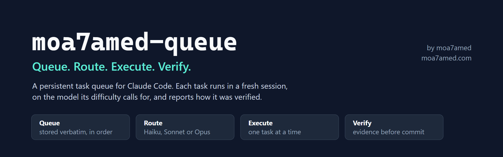 | Overview banner (text wordmark, tagline, the four steps) |
| 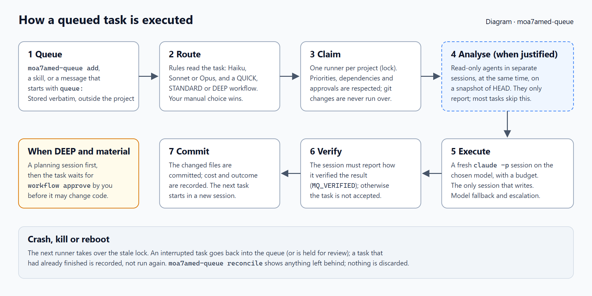 | Diagram: queue, route, claim, optional analysis, execute, verify, commit; approval of material deep plans; crash recovery |
| 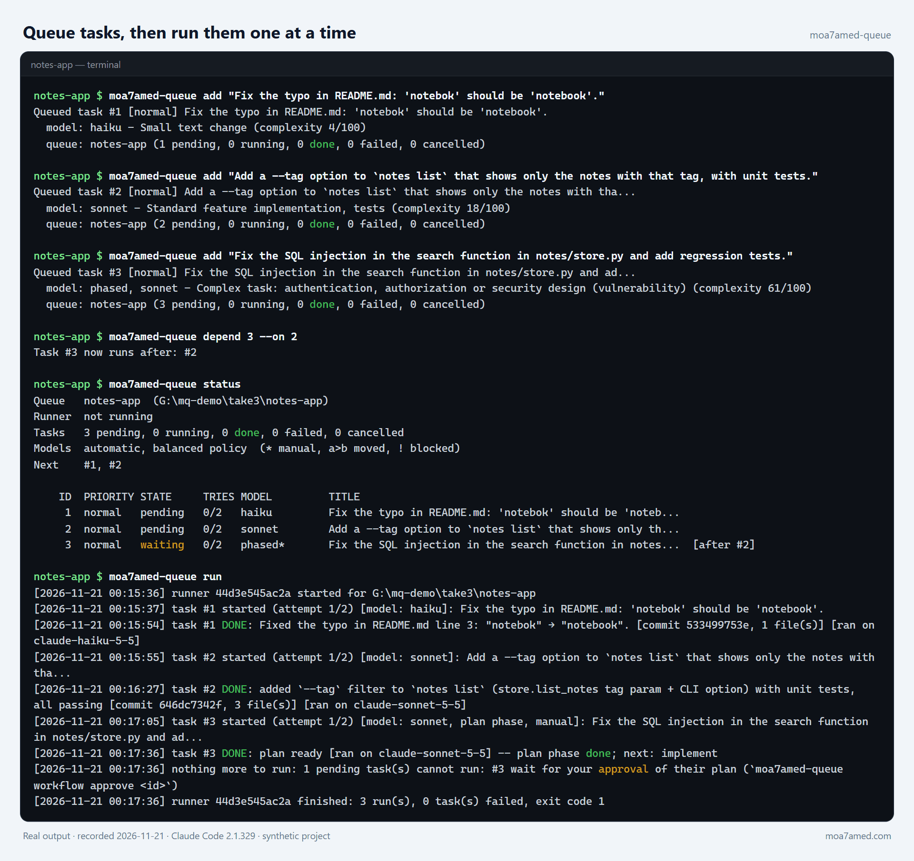 | Queue submission, dependency and sequential execution |
| 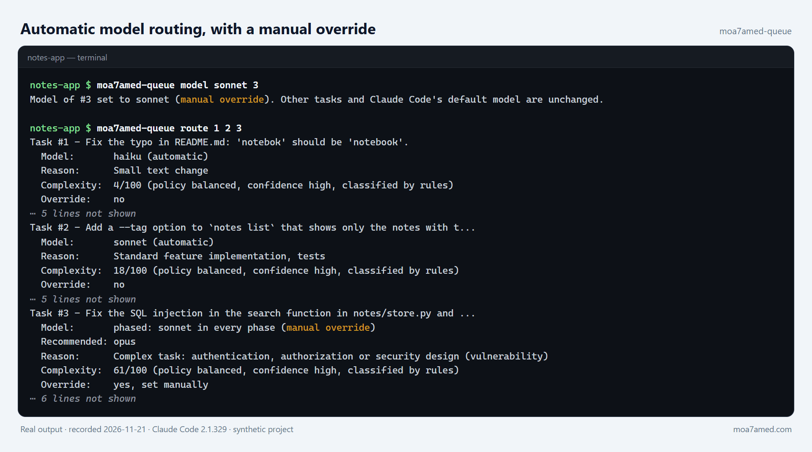 | Automatic model routing and a manual override |
| 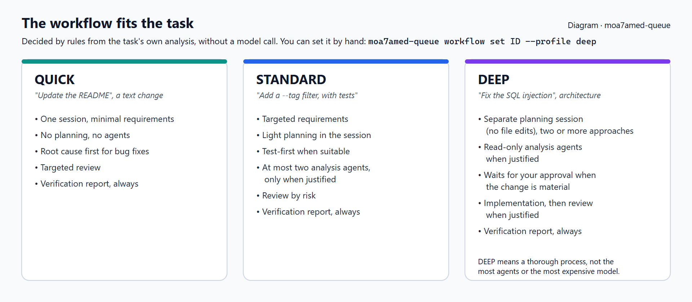 | Diagram: QUICK, STANDARD and DEEP |
| 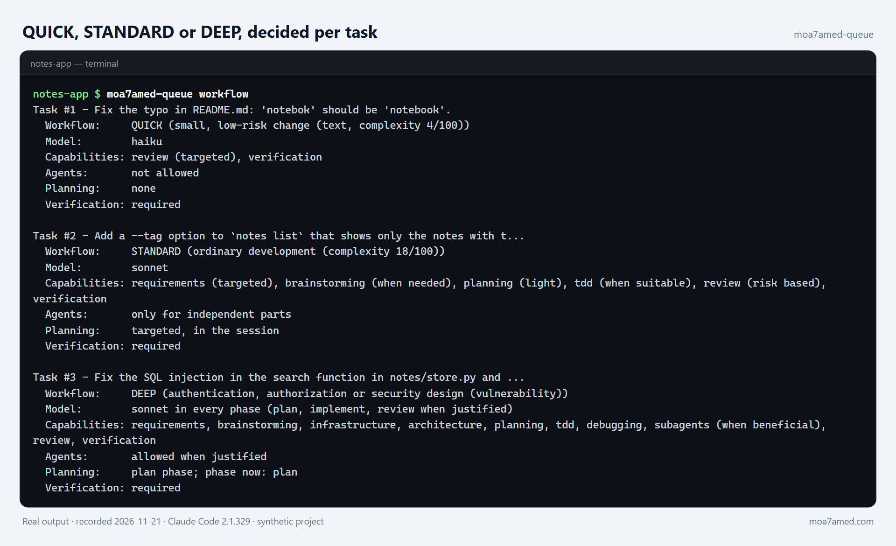 | Each task's workflow as the CLI reports it |
| 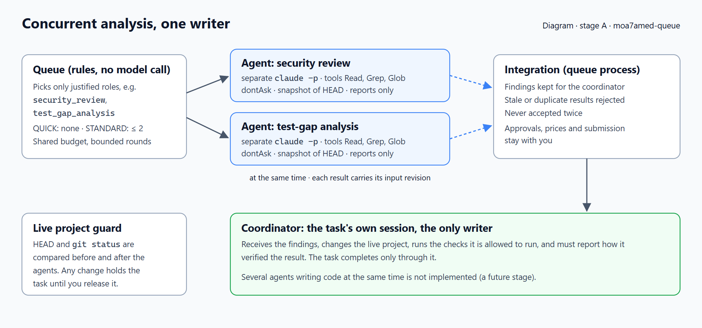 | Diagram: concurrent read-only agents, one writer |
| 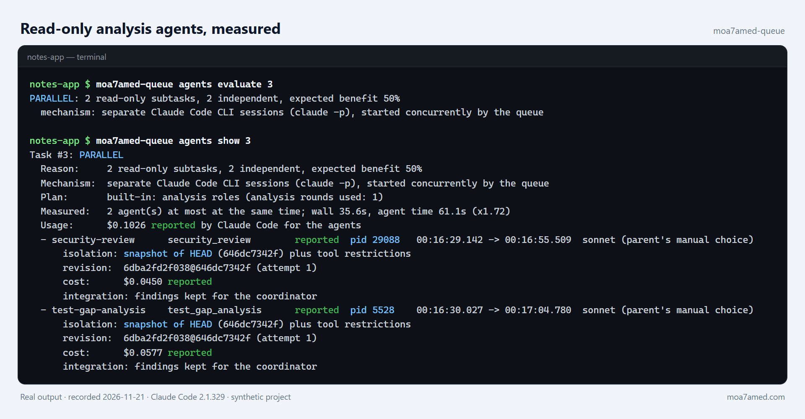 | The two agents of task 3, measured |
| 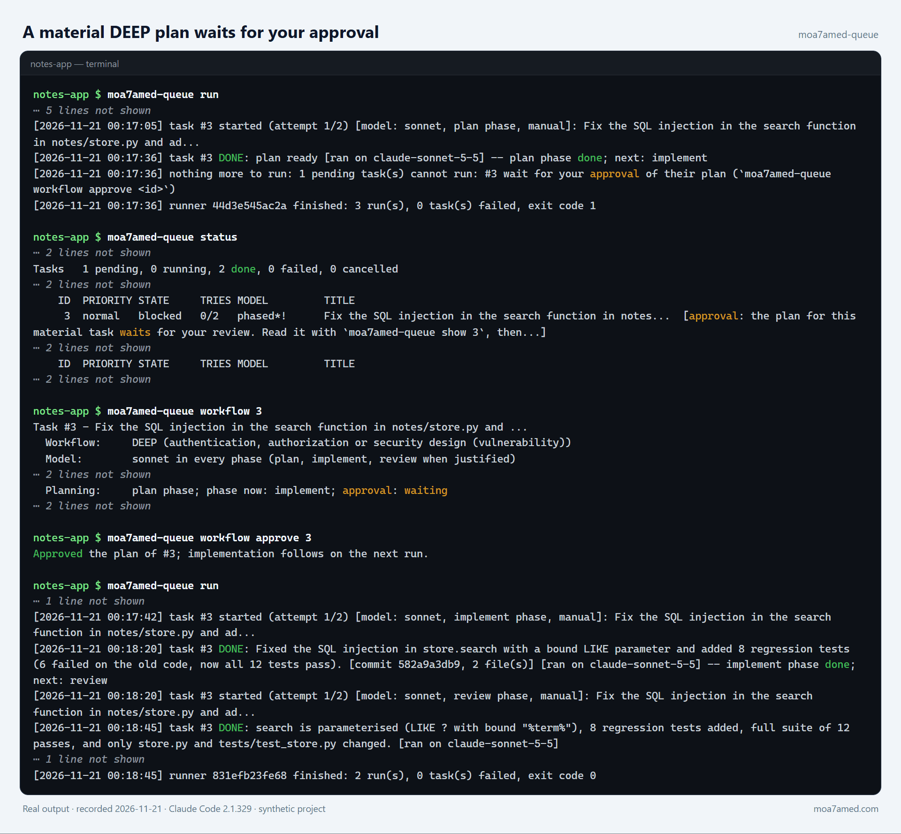 | A material DEEP plan waiting for, and receiving, approval |
| 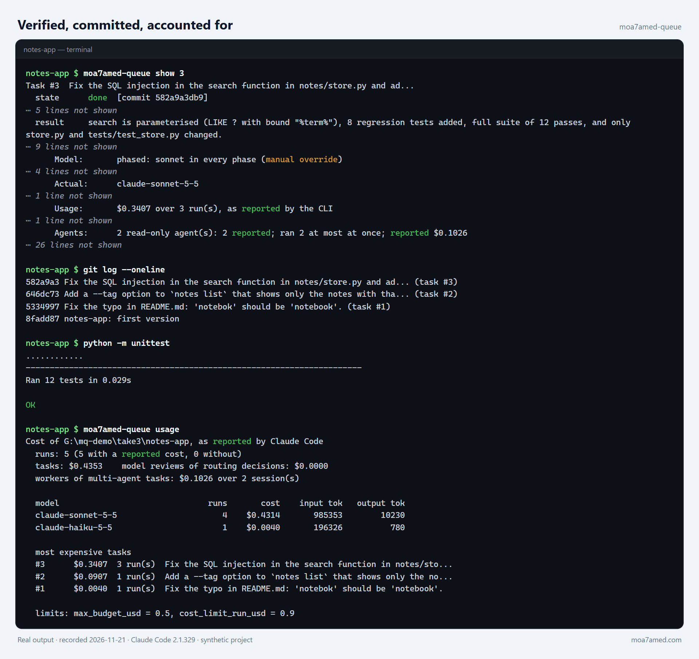 | Result, commits, tests and costs |
| 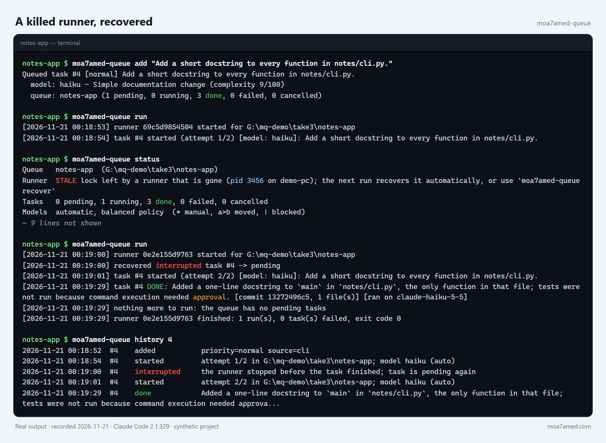 | A killed runner and its recovery |
| 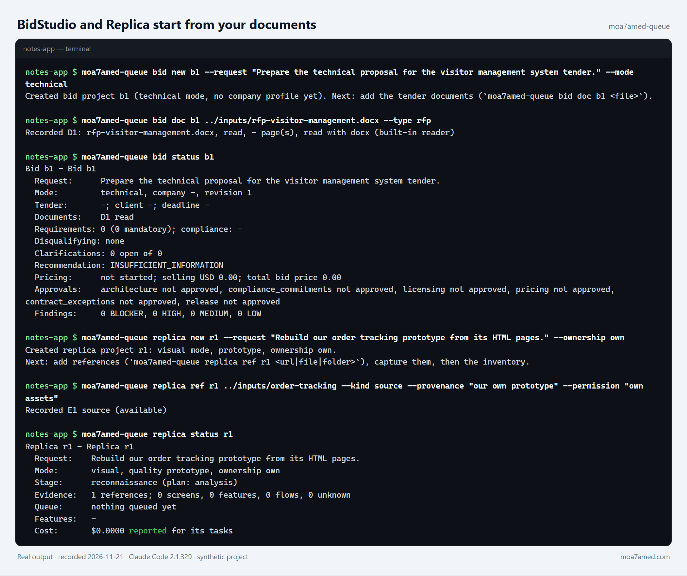 | First steps of BidStudio and Replica |

The alt text of every image is also in
[media/images/ALT.json](media/images/ALT.json).

## Verification of these files

Checked on 2026-11-21 with `python docs/media/source/verify_media.py` and by eye:

- Every video was played to its end in Chromium with its caption track loaded:
  1920×1080; the main cuts last 165.2 s with 13 captions, the short cuts 36.1 s with 6;
  the last caption ends with the video.
- Frames from every scene of the English and Arabic main videos and of both short videos
  were extracted and looked at: text readable, Arabic shaped and right to left, badges
  present, the website on the last card.
- Every image was opened and looked at; every relative link in this page, the README and
  the media README resolves.
- Every line of terminal text was compared with the recorded session; the recording was
  searched for user-home paths, the real host name, e-mail addresses, keys and session
  ids (none left).

This checks the media, not the software: the plugin's own test results are in the
changelog and the release checklist.

## Rebuilding and licences

How the files were made, what is tracked in git, and the licence of every part:
[media/README.md](media/README.md).
